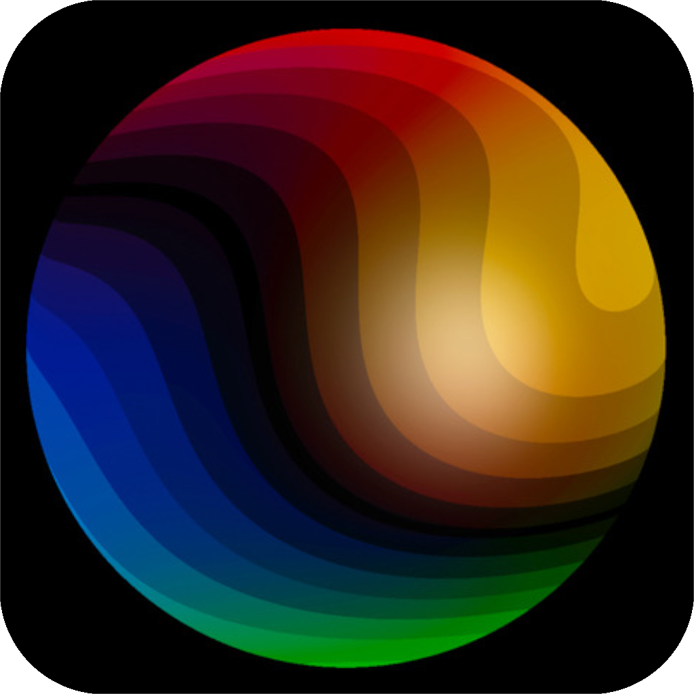

# GeneralizedBEADS
A MATLAB app and library for visualizing pure and mixed quantum states using the generalized BEADS representation. The generalized BEADS Representation is a mathematically and informationally complete approach for the visualization of qubit system states.

## The generalized BEADS representation
The provided library and app use the generalized BEADS representation (see https://arxiv.org/pdf/2610.19054) to visualize the correlation structure of qubit systems.

## How to use the app or codebase
Download or clone the repository. Then follow the instructions in *Documentation/DocumentationMATLAB.pdf* to operate the code or run the app.

## How to reference this repository
You can reference GeneralizedBEADS in publications as you would reference a book.
* Authors: Dennis Huber, Celina Bräutigam, and Steffen J. Glaser
* Title: GeneralizedBEADS
* Edition: 1.0.0
* Address: Technical University of Munich, Garching, Germany
* Date of publication: 2026
* Retrieved from: https://github.com/denhub97/GeneralizedBEADS

 

